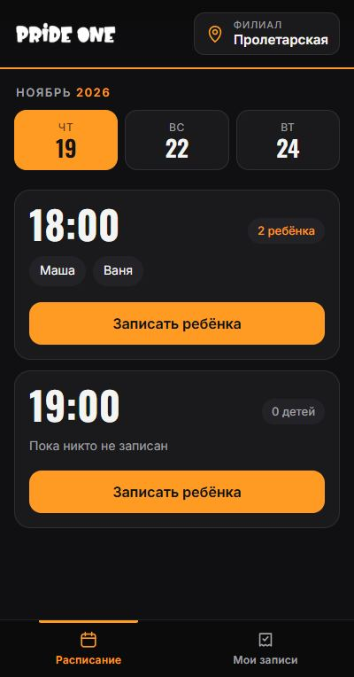
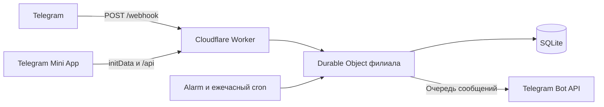

<div align="center">

# 🥋 PRIDE ONE · запись на тренировки

**Telegram-бот и Mini App для филиала «Пролетарская». Расписание, запись ребёнка и отмена доступны из одного чата.**

   

[Открыть бота](https://t.me/PrideOneBookingBot) · [Как работает запись](#как-работает-запись) · [Архитектура](#архитектура) · [Локальный запуск](#локальный-запуск)

</div>

## Как работает запись

- **Родитель** выбирает день и время на панели группы, затем отвечает именем ребёнка на сообщение бота. Подтверждение содержит кнопку отмены. В «Моих записях» видны собственные брони.
- **Администратор группы** публикует панель командой `/init P03`. Повтор команды обновляет существующую панель. Команда `/help` показывает подсказку.
- **Участники филиала** видят список на выбранную дату и число записавшихся. После отмены бот обновляет список и отправляет в группу отдельное уведомление.
- **В Mini App** тот же сценарий доступен через расписание и раздел «Мои записи». У чата и приложения общие правила бронирования. Данные Telegram и членство пользователя в группе проверяет Worker.

<details open>
<summary>Расписание в Telegram Mini App</summary>



Снимок сделан в локальном макете из репозитория. Имена и записи на нём тестовые.

</details>

## Архитектура



| Технология | Что делает в проекте |
| --- | --- |
| [Worker](src/index.js) | Проверяет секрет webhook, определяет филиал по чату и проверяет право администратора |
| [Mini App API](src/miniapp.js) | Проверяет подпись и возраст Telegram initData, обслуживает расписание и личные записи |
| [BranchBookingDO](src/branch-do.js) | Выполняет запись, отмену и постановку уведомлений в очередь внутри транзакций SQLite |
| [Mini App](mini-app/README.md) | Мобильный HTML/CSS/JavaScript-интерфейс, который раздаёт тот же Worker через Static Assets |

Бронь и задание на отправку сообщения сохраняются в одной транзакции. Повтор Telegram update распознаётся по `update_id`, а индекс SQLite препятствует дублированию активной брони того же ребёнка у одного родителя на тот же слот. Если Telegram временно недоступен, очередь повторяет отправку. При потере ответа на уже доставленное сообщение возможен повтор уведомления. На количество броней это не влияет.

<details>
<summary>Устройство хранилища и восстановление после сбоя</summary>

| Данные SQLite | Для чего нужны |
| --- | --- |
| `bookings`, `booking_events` | Активные и отменённые записи и история действий. Отмена меняет статус брони и проверяет владельца. |
| `pending_prompts`, `telegram_updates` | Одноразовые формы ответа и идентификаторы уже обработанных событий. |
| `telegram_messages`, `day_state` | Сообщения группы и версия списка участников на выбранную дату. |
| `outbox`, `meta` | Задачи отправки, число попыток, время повтора, версия схемы и служебное состояние. |

При ответе Telegram 429 исполнитель учитывает `retry_after`. При временной сетевой ошибке задержка между повторами растёт. Список дня собирается из текущих записей перед отправкой, поэтому повтор задачи учитывает изменения, внесённые после её создания.

Исторический импорт из KV восстанавливает связи со старыми сообщениями и проверяет число активных броней в транзакции. При расхождении транзакция откатывается. Подробная процедура сохранена в [инструкции перехода](UPDATE_2.0.2.md).

</details>

## Локальный запуск

Для тестового окружения требуется Node.js 22.13 или новее. Из корня проекта выполните

```sh
npm ci
npm run mini:build
npm run mini:dev
```

Откройте `http://localhost:5173/?dev_init=mock`. Локальный сервер имитирует расписание и хранит записи в памяти. Для просмотра этого интерфейса не нужны Telegram-аккаунт и ключи Cloudflare.

Для разработки Worker подготовьте локальный `.dev.vars` по [.dev.vars.example](.dev.vars.example) и запустите `npm run dev` после сборки Mini App. Используйте отдельные тестовые значения.

| Переменная | Назначение |
| --- | --- |
| `BOT_TOKEN` | Доступ серверной части к Telegram Bot API |
| `WEBHOOK_SECRET` | Проверка входящих webhook-запросов |
| `ADMIN_SECRET` | Доступ к служебным маршрутам |
| `BRANCH_CHATS` | JSON-соответствие филиалов и разрешённых чатов |

## Тестирование

| Команда | Что проверяет |
| --- | --- |
| `npm test` | Запись и отмену, повторную доставку, панель группы, обновление данных и API Mini App в локальном эмуляторе |
| `npm run check:local` | Конфигурацию разработки с допустимыми заполнителями |
| `npm run mutation` | Способность тестов обнаруживать изменения в защитных проверках (нужен Bash) |
| `npm run build:dry` | Сборку Wrangler без публикации |

## Работа с действующим ботом

Репозиторий соответствует существующему Worker `pride-one-bot`. Перед обновлением сверяют аккаунт Cloudflare, привязки Durable Objects и KV, cron и имена секретов по [инструкции синхронизации](WORKER_SYNC.md). Production-шаг workflow запускается вручную с подтверждением для существующего Worker. Обычный push не переключает webhook.

[Первоначальная настройка](FIRST_RUN.md) и [переход с версии 2.0.1 на 2.0.2](UPDATE_2.0.2.md) описывают исторические операции. Подробности локального стенда и ручной проверки приведены в [документации Mini App](mini-app/README.md).
